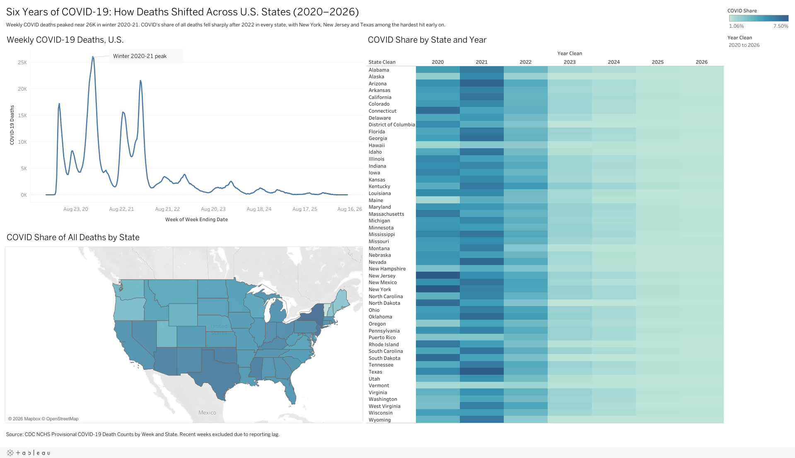

# COVID-19 Deaths Across U.S. States (2020-2026)

**Live dashboard:** [View on Tableau Public](https://public.tableau.com/app/profile/atharva.kurlekar/viz/COVID-19DeathsAcrossU_S_States2020-2026/Dashboard1)

## Question
How did COVID-19 mortality shift across U.S. states over six years, and which states were hit hardest relative to all deaths?

## Data
CDC NCHS, Provisional COVID-19 Death Counts by Week Ending Date and State (data.cdc.gov). About 18.6K weekly records across 50 states, DC and Puerto Rico.

## Methods
- Filtered to weekly records and excluded the national total to avoid double counting
- Merged New York City into New York State (CDC reports them separately)
- Built a clean year field from week-ending dates to fix blank year values
- Calculated COVID share of total deaths as the main comparison metric
- Excluded the most recent weeks because of death-certificate reporting lag

## Key insights
- Weekly COVID deaths peaked near 26K in winter 2020-21
- COVID's share of all deaths fell sharply after 2022 in every state
- New York, New Jersey and Texas were among the hardest hit early on

## Tools
Tableau Public
